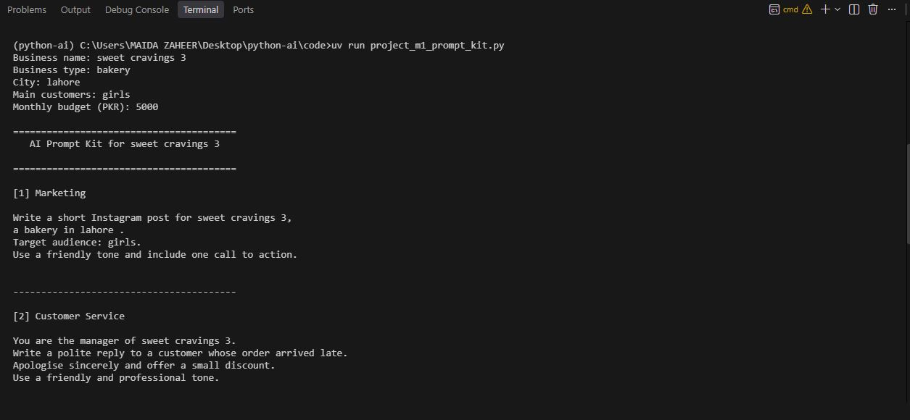
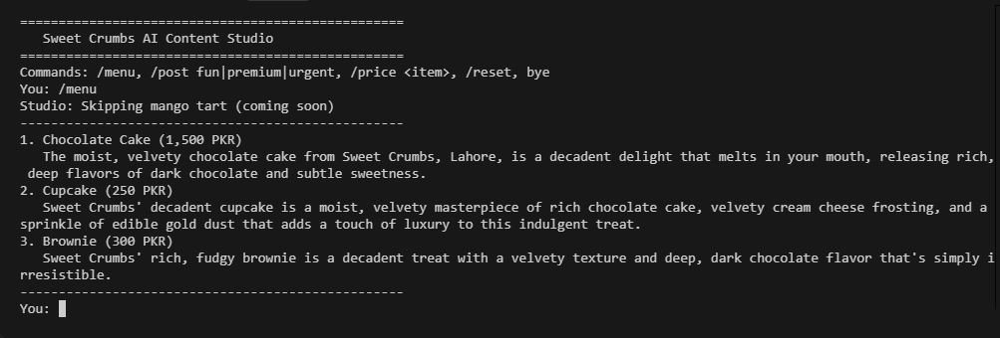

# My AI Dev Toolkit

**Name:** Maida Zaheer

**Course Name:** AI for Everyone

**My AI Goal:** My goal is to learn AI engineering and build useful AI applications, chatbots, and voice agents.

## How to Run

Run the following command in the terminal:

uv run main.py


## Lessons Completed So Far

1. Introduction to Artificial Intelligence (AI)
2. Generative AI
3. Large Language Models (LLMs)
4. Difference between Chatbots, Assistants, and Agents
5. Introduction to Python
6. Python `print()` function
7. Using f-strings in Python
9. Introduction to `uv` and Python environments
10. Introduction to Ollama and local LLMs
11. Basic AI application architecture
12. Introduction to Git/GitHub and VS Code

# Folder Structure

python-ai/
├── code/             # Store Python code
├── notebooks/        # Store Jupyter notebooks
├── docs/             # Store project documentation
├── .gitignore        # Files Git should ignore
├── .python-version   # Python version for the project
├── main.py           # Main Python program
├── pyproject.toml    # Project details and dependencies
├── uv.lock           # Exact dependency versions
└── README.md         # Project information and instructions

## Module 1 Project: AI Prompt Kit

A Python tool that turns a local business's details into 3 ready-to-use AI prompts.

**Run:** `uv run code/project_m1_prompt_kit.py`



**Who would pay for this:** (one line, e.g. small shop owners who want AI help but don't know what to type)


## Business Helper Bot — Intent Design Table

| Intent | Keywords to Check | Bot Reply |
|---|---|---|
| Greeting | `hi`, `hello` | Hello! How can I help you? |
| Timings | `timing`, `hours`, `open` | We are open 10 am to 8 pm, Monday to Saturday. |
| Fees | `fee`, `price`, `cost` | Consultation fee is 2,000 PKR. |
| Location | `location`, `address`, `where` | We are located in Lahore. |
| Appointment | `appointment`, `book`, `booking` | Please call the clinic to book an appointment. |
| Complaint | `complaint`, `late`, `problem` | Sorry about that. The clinic manager will call you today. |

## Module 1 Project: Sweet Crumbs Front Desk Assistant

A beginner-friendly Python front desk bot for a bakery that answers FAQs, calculates quotes with bulk discounts and delivery fees, and prepares prompts for unanswered questions.

### Run

```bash
uv run code/project_m1_front_desk.py
```

### Screenshot

See `docs/project_m1-part2-run.png` for a sample session. Regenerate or replace it with a screenshot from your own terminal after running the script.

### Value to the owner

The bot can reduce repetitive staff replies and pricing mistakes by answering common questions instantly and calculating quotes consistently; the owner can review the session report to see what customers ask most often.

## Module 2 Checkpoint 1: AI Content Studio (Sweet Crumbs)

A command-line studio that writes menu descriptions and social media posts for a local bakery, answers prices from real data, and chats with customers using only verified facts.

**Run it:**

```bash
uv run code/project_m2_content_studio.py
```

**Screenshot:**



**Value to the owner:** it replaces hours of monthly copywriting with one command, and it never invents a price because prices come straight from the owner's own data, which is why a business would pay for it every month.

**Docs:** [design and feature tests](docs/project-m2-cp1-design.md) · [AI quality results](docs/project-m2-cp1-results.md)


# Sweet Cravings Diaries — AI Business Assistant

An Ollama-powered Python agent that answers from bakery owner data, checks orders, imports WhatsApp order messages, and saves orders only after owner approval.

## Run

From the project root, install dependencies into your existing `uv` project as needed. Then:

```cmd
cd code
uv run project_m2_business_assistant.py
```

Make sure Ollama is running and the model is available (default: `gemma3:1b`). Update `MODEL` and `EXTRACTOR_MODEL` in the script if using another installed model.

## Tools

| Tool | What it does |
|---|---|
| `get_price` | Reads a price from business.json |
| `get_info` | Reads business information from business.json |
| `order_status` | Checks order status in orders.json |
| `place_order` | Calculates total in Python; asks owner approval before saving |

Commands: `/import`, `/orders`, `/reset`, `bye`.

## Owner data
Edit `code/business.json` to update menu prices or business facts. The assistant reads this file at startup. Operational records are local and excluded by `.gitignore`.

## Value to the owner
This assistant reduces daily time spent answering repetitive price and business-information questions, checking incoming order messages, calculating totals, and maintaining order records; a monthly service could be paid for because it saves time while keeping the owner in control of every order.

## Project documents
- `docs/project-m2-final-design.md` — design, guardrails, and test tables
- `docs/project-m2-final-results.md` — AI quality tests and improvement record

## Screenshot
Capture a real terminal session including the session report after running the program. Do not use a fabricated screenshot.


# Lesson 2.7 — Order Extractor

Python + Ollama order extraction for Sweet Cravings Diaries.

## Run
```cmd
cd code
uv run lesson_2_7_extractor.py
```
Ensure Ollama is running and download the model:
```cmd
ollama pull gemma3:1b
```
Dependencies expected in the uv project: `langchain-core`, `langchain-ollama`, `ollama`, `httpx`.

Files:
- `code/lesson_2_7_extractor.py` — extractor
- `docs/hallucination-hunt.md` — risk tests and run-record template

It also creates `orders.json` and `orders.csv` in the code folder at runtime. Test outputs depend on the local model; record actual findings rather than claiming unrun tests.
